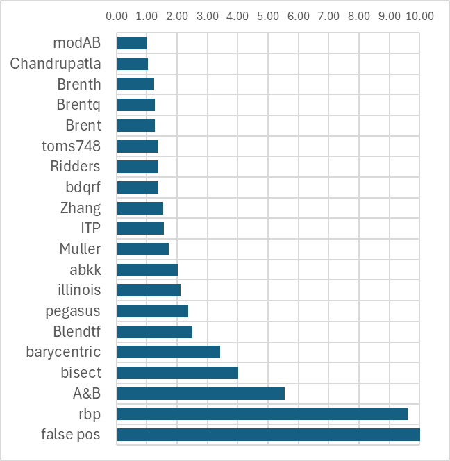

### Results summary

Code and benchmarks are based on this [Roots-Fortran](https://github.com/jacobwilliams/roots-fortran) 
by [Jacob Williams](https://github.com/jacobwilliams) fork:   
https://github.com/Proektsoft-EOOD/roots-fortran

Relative number of evaluations to modAB:

 
 Summary of results from the 157 function tests (`modab` is the rational modab, RModAB):
Method | bisection | false pos | abkk | barycentr | zhang | ridders | illinois | blendtf | itp | bdqrf | rbp | pegasus | toms748 | brent | brentq | A&B | brenth | muller | modab | chandr
-- | -- | -- | -- | -- | -- | -- | -- | -- | -- | -- | -- | -- | -- | -- | -- | -- | -- | -- | -- | --
Sum | 10130 | 89207 | 5080 | 8605 | 3884 | 3489 | 5319 | 6322 | 3925 | 3503 | 24279 | 5995 | 3482 | 3229 | 3227 | 13968 | 3167 | 4371 | 2522 | 2634
Ave | 45.4 | 400.0 | 22.8 | 38.6 | 17.4 | 15.6 | 23.9 | 28.3 | 17.6 | 15.7 | 108.9 | 26.9 | 15.6 | 14.5 | 14.5 | 62.6 | 14.2 | 19.6 | 11.3 | 11.8
Max | 86 | 1086 | 100 | 334 | 92 | 94 | 175 | 104 | 54 | 92 | 2052 | 204 | 148 | 128 | 128 | 1086 | 128 | 339 | 52 | 54
Mean | 42.9 | 104.9 | 19.9 | 31.2 | 15.8 | 13.8 | 16.4 | 24.3 | 14.8 | 13.7 | 16.0 | 15.8 | 12.2 | 11.7 | 11.7 | 16.5 | 11.4 | 12.5 | 10.3 | 10.8
Best | 10 | 8 | 0 | 3 | 1 | 8 | 11 | 10 | 11 | 9 | 22 | 45 | 48 | 54 | 54 | 59 | 67 | 67 | 92 | 57
Worst | 92 | 108 | 1 | 11 | 0 | 0 | 0 | 0 | 0 | 0 | 10 | 0 | 0 | 0 | 0 | 8 | 0 | 1 | 0 | 0
Median | 47.0 | 57.0 | 20.0 | 30.0 | 16.0 | 14.0 | 12.0 | 26.0 | 13.0 | 14.0 | 12.0 | 11.0 | 11.0 | 11.0 | 11.0 | 10.0 | 10.0 | 10.0 | 10.0 | 10.0
Std Dev | 10.7 | 480.4 | 15.1 | 39.6 | 10.2 | 10.8 | 27.4 | 15.5 | 12.3 | 10.3 | 417.8 | 37.0 | 17.9 | 15.1 | 15.1 | 202.1 | 15.2 | 34.2 | 6.5 | 6.8
Std Error | 0.72 | 32.17 | 1.01 | 2.65 | 0.68 | 0.73 | 1.83 | 1.04 | 0.82 | 0.69 | 27.98 | 2.48 | 1.20 | 1.01 | 1.01 | 13.53 | 1.02 | 2.29 | 0.43 | 0.46
Rel | 4.02 | 35.37 | 2.01 | 3.41 | 1.54 | 1.38 | 2.11 | 2.51 | 1.56 | 1.39 | 9.63 | 2.38 | 1.38 | 1.28 | 1.28 | 5.54 | 1.26 | 1.73 | 1.00 | 1.04

Detailed results are available here:
[Test_results.pdf](/Fortran/results/Test_results.pdf)

### Timing results

Wall-clock time of each solver over the 223 cases, median of 35 passes over the whole
set, with the per-call overhead of the library API removed (see below):

| Method | Evals | Time, µs | Rel |
|---|--:|--:|--:|
| **modab** | **2522** | **69.0** | **1.00** |
| chandr | 2634 | 70.5 | 1.02 |
| brenth | 3167 | 80.5 | 1.17 |
| brentq | 3227 | 81.8 | 1.19 |
| brent | 3229 | 85.8 | 1.24 |
| zhang | 3884 | 89.6 | 1.30 |
| ridders | 3489 | 91.2 | 1.32 |
| bdqrf | 3503 | 102.6 | 1.49 |
| abkk | 5080 | 120.1 | 1.74 |
| toms748 | 3482 | 123.0 | 1.78 |
| blendtf | 6322 | 128.1 | 1.86 |
| illinois | 5319 | 146.9 | 2.13 |
| muller | 4371 | 150.4 | 2.18 |
| itp | 3925 | 173.7 | 2.52 |
| barycentr | 8605 | 177.2 | 2.57 |
| pegasus | 5995 | 199.4 | 2.89 |
| bisection | 10130 | 220.2 | 3.19 |
| A&B | 13968 | 434.5 | 6.30 |
| rbp | 24279 | 801.6 | 11.62 |
| false pos | 89207 | 2674.6 | 38.77 |

Rel is relative to modab. The rational modab (RModAB) is the fastest, 2 % ahead of
Chandrupatla, because it needs the fewest evaluations, 4 % fewer than Chandrupatla, at a
similar cost of about 27 ns per evaluation.

Through the library API every call also pays a fixed 3–7 µs (stack trampolines for
internal procedures; a system call on Windows), which is 10–20 times modab's own run
time and makes the methods hard to tell apart: 1578 µs per pass through `root_scalar`
and 765 µs through `solver%solve` for modab, against 1658 µs and 760 µs for Chandrupatla.

Intel Core i7-1065G7, Windows 11, gfortran 16.1, fpm `--profile release`.
Details and method: [Timing_results.md](/Fortran/results/Timing_results.md)
